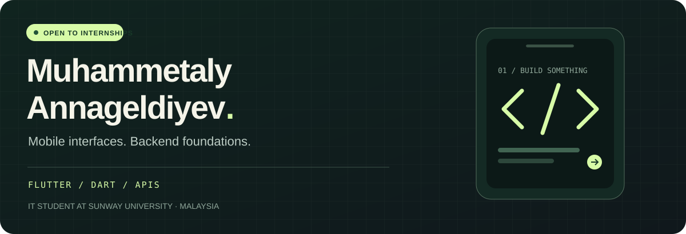
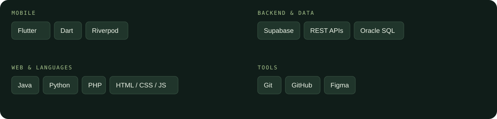

  <a href="https://dev-muhammetaly.github.io/portfolio"><strong>VIEW PORTFOLIO ↗</strong></a>
  &nbsp;&nbsp; / &nbsp;&nbsp;
  <a href="https://www.linkedin.com/in/muhammetaly-annageldiyev-497608351/"><strong>LET'S CONNECT ↗</strong></a>
  &nbsp;&nbsp; / &nbsp;&nbsp;
  <a href="https://nextrolejob.netlify.app"><strong>TRY NEXTROLE ↗</strong></a>

 

### A little about me

I'm studying Information Technology at **Sunway University in Malaysia**. Most of my recent work is with Flutter and Dart, connecting app interfaces to authentication, databases and REST APIs.

I started learning Flutter through independent online coursework and continued building on it in university projects. I'm looking for a **mobile or backend development internship** where I can contribute, learn from other developers and work on a shared codebase.

 

### 01 — Selected projects

<table>
<tr>
<td width="50%" valign="top">
<h3>↗ Nextrole</h3>

A job-search app with candidate, employer and admin workspaces. Job discovery, applications, résumé storage and moderation in one project.

<code>Flutter</code> <code>Dart</code> <code>Supabase</code>

<a href="https://github.com/dev-muhammetaly/nextrole"><strong>Explore code →</strong></a> &nbsp; <a href="https://nextrolejob.netlify.app">Live demo ↗</a>

</td>
<td width="50%" valign="top">
<h3>↗ Restaurant App</h3>

Browse a menu, build a cart, place an order and return to your order history. An ordering project with accounts and stored orders.

<code>Flutter</code> <code>Riverpod</code> <code>Supabase</code>

<a href="https://github.com/dev-muhammetaly/restaurant_app"><strong>Explore code →</strong></a> &nbsp; <a href="https://m-restaurant-app.netlify.app">Live demo ↗</a>

</td>
</tr>
<tr>
<td width="50%" valign="top">
<h3>↗ UniPlan</h3>

Turn a timetable image into calendar entries with an AI API. Schedules stay local. A prototype; extracted entries still need checking.

<code>Flutter</code> <code>OpenRouter</code> <code>Hive</code>

<a href="https://github.com/dev-muhammetaly/UniPlan"><strong>Explore code →</strong></a>

</td>
<td width="50%" valign="top">
<h3>↗ GigLaunch</h3>

A PHP job board with worker, employer and admin areas. A project exploring server-rendered pages, sessions and relational data.

<code>PHP</code> <code>MySQL</code> <code>HTML / CSS</code>

<a href="https://github.com/dev-muhammetaly/gig-launch-php"><strong>Explore code →</strong></a>

</td>
</tr>
</table>

A closer look at Nextrole

 

Local design preview with fictional records, not live user data.

 

### 02 — My toolkit

Flutter is my main focus. I also work with Firebase Realtime Database and keep developing my backend fundamentals. My networking coursework covers TCP/IP, VLANs, EtherChannel/LACP and Spanning Tree Protocol.

 

### 03 — Beyond the projects

<table>
<tr>
<td width="50%" valign="top">
<h4>EDUCATION</h4>

<strong>BSc (Hons) Information Technology</strong> Sunway University February 2025 – January 2028 (expected)

Coursework in mobile development, web programming, databases, software engineering and networks.

</td>
<td width="50%" valign="top">
<h4>RECOGNITION &amp; INVOLVEMENT</h4>

<strong>Dean's List</strong> · February 2026 semester

<strong>Department Representative, FET</strong> November 2025 – July 2026 Represented student concerns and worked with faculty on academic and welfare matters.

<strong>Campus to Career Bootcamp</strong> · June 2026

</td>
</tr>
</table>

Turkmen is my native language. I also speak Turkish and English, and conversational Russian.

My repositories include larger portfolio projects and smaller learning exercises. Their READMEs explain what works, how to run them and what is still unfinished.

 

---

<strong>Have an internship opportunity or a project in mind?</strong>  
<a href="https://www.linkedin.com/in/muhammetaly-annageldiyev-497608351/">Let's talk on LinkedIn ↗</a> &nbsp;·&nbsp;
<a href="https://dev-muhammetaly.github.io/portfolio">Visit my portfolio ↗</a>

